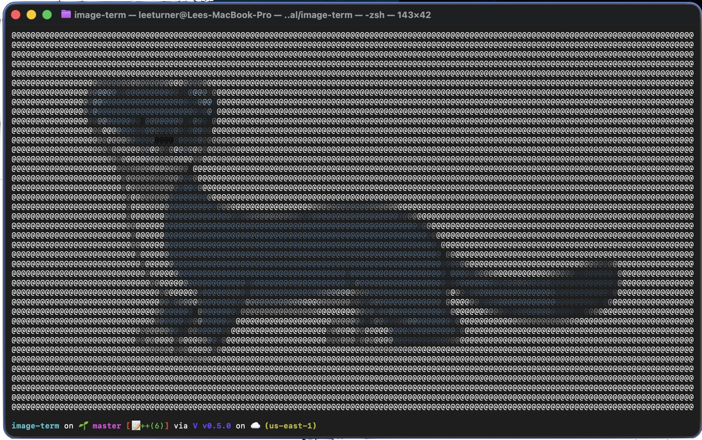

# image-term

[](LICENSE)

A terminal image viewer written in [V](https://vlang.io/) that renders images as colourful ASCII mosaics. It's based
on the blog post
[Convert an Image into Colourful Ascii Art](https://linyunliu.com/blogs/convert-an-image-into-colourful-ascii-art/),
and I wrote about building it in
[Convert an Image into Colourful Ascii Art - Vlang Edition](https://leeturner.me/post/image-term-vlang/).



## How it works

image-term loads an image, resizes it to fit your terminal and draws it with coloured `@` characters. It:

- Detects the size of your terminal and scales the image to fit
- Corrects for the aspect ratio of terminal characters, which are taller than they are wide
- Averages the colours of the pixels within each block, so each character has the right colour
- Supports greyscale, RGB and RGBA images through [stb_image](https://github.com/nothings/stb)

## Requirements

- The [V compiler](https://vlang.io/)
- A terminal with true colour (24-bit) support

## Building

```sh
v -o image-term .
```

## Usage

```sh
./image-term <image-path>
```

For example:

```sh
./image-term ~/Pictures/holiday.jpg
```

It reads any format stb_image supports: JPEG, PNG, BMP, GIF, PSD, TGA, HDR, PIC and PNM.

## Licence

Apache 2.0. See [LICENSE](LICENSE).
